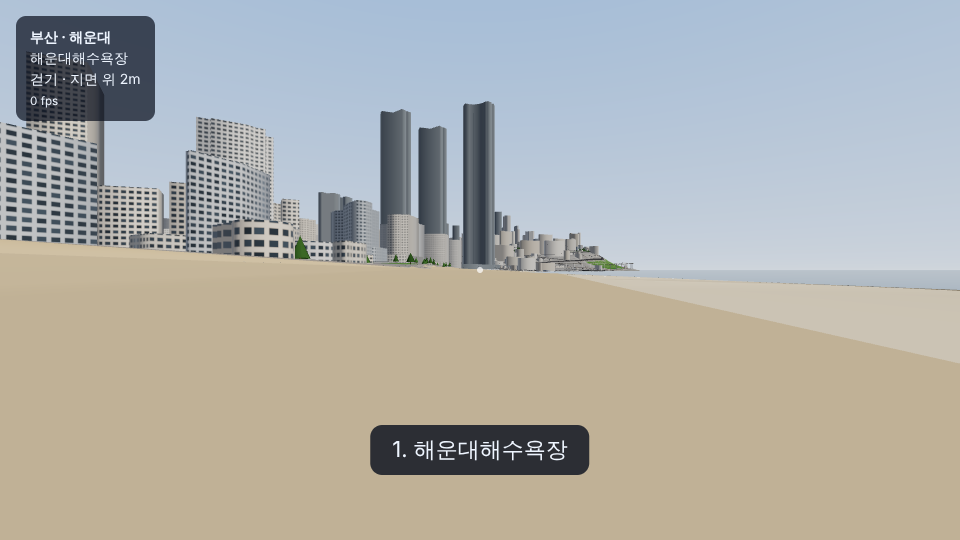
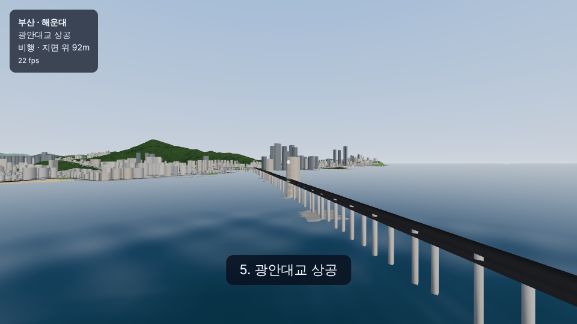
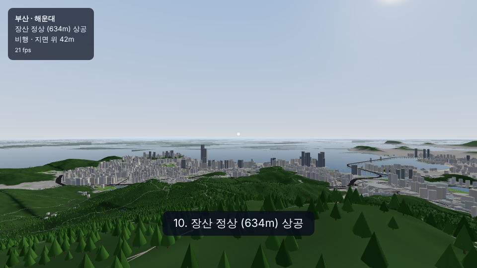
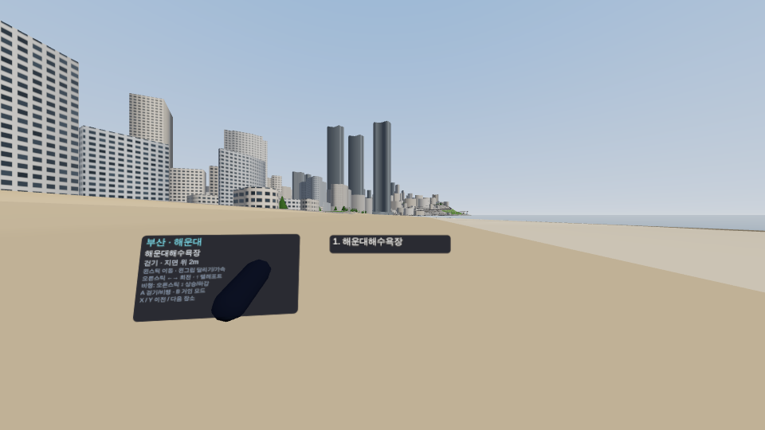

# 부산 VR (Meta Quest 3 · WebXR)

실제 지도 데이터로 만든 부산을 Quest 3 브라우저에서 걷고 날아다니며 둘러보는 몰입형 웹 앱입니다.
지금은 **해운대** 지역이 들어 있고, 다른 지역은 같은 파이프라인으로 계속 추가합니다.

- 배포 주소: **https://joyong133.github.io/Gta-vr/busan/** (GitHub Pages — 아래 "배포")
- 로컬: `npm run dev` → `http://localhost:5173/busan/` (같은 와이파이의 Quest는 `adb reverse tcp:5173 tcp:5173` 후 `http://localhost:5173/busan/`)

| 해운대해수욕장 (걷기) | 광안대교 상공 (비행) | 장산 상공 | VR (왼손 패널) |
|---|---|---|---|
|  |  |  |  |

> 스크린샷은 헤드리스 Chromium(소프트웨어 렌더러) 자동 테스트에서 찍은 것입니다.

## 조작

| 동작 | Quest 3 Touch | 데스크톱 |
|---|---|---|
| 이동 (보는 방향 기준) | 왼스틱 | WASD |
| 달리기 / 비행 가속 | 왼쪽 그립 | Shift |
| 45° 스냅 회전 | 오른스틱 ← → | 마우스 |
| 텔레포트 (걷기, 옥상 위로도 가능) | 오른스틱 ↑ 조준 → 놓기 | T 누르고 떼기 |
| 상승 / 하강 (비행) | 오른스틱 ↑ ↓ | Space / C |
| 걷기 ↔ 비행 | A | F |
| 거인 모드 (×30, 도시가 미니어처처럼 보임) | B | G |
| 이전 / 다음 장소 | X / Y | `[` `]` 또는 숫자 1~0 |
| 상태·조작법 패널 | 왼손을 들어 보기 | 화면 왼쪽 위 |

걷을 때는 건물 벽에 막히고, 계단 높이(0.7m)까지는 올라서며, 옥상에서 떨어지면 중력으로 내려옵니다.

### 해운대 장소 (X/Y로 순서대로 이동)
해운대해수욕장 · 엘시티 랜드마크타워 옥상(411m) · 동백섬 · 마린시티 · 광안대교 상공 · 광안리해수욕장 · 센텀시티·벡스코 · 달맞이길 · 송정해수욕장 · 장산 정상(634m) 상공

## 폴더 구조

```
busan/
  index.html            부산 VR 페이지 (Vite 두 번째 입력 → 배포 시 /busan/)
  src/
    main.ts             렌더러·XR 세션·입력(Quest/데스크톱)·타이틀 화면
    World.ts            지역 에셋 로딩, 재질 연결, 거리별 타일 표시(Quest 부하 조절), 나무 인스턴싱
    Player.ts           리그·걷기/비행/텔레포트/거인 모드·스냅 회전·장소 이동
    Ground.ts           높이맵 + 건물 외곽선 질의(지면, 옥상, 벽 충돌) — three.js 없이 단위 테스트
    materials.ts        창문 셰이더(벽 UV), 바다/강 셰이더, 하늘
    Hud.ts              왼손 패널, 토스트, 데스크톱 HUD
    regions.ts          busan/regions/*/region.json 자동 등록
  regions/<지역>/        웹 에셋(파이프라인 결과, 저장소에 포함)
    region.json         이름·워프 지점·높이맵 격자·재질 값·통계
    terrain.glb         상세 지형(RTIN 타일, 오차 0.3m 이내)
    backdrop.glb        바깥 25km 배경 지형
    city.glb            건물(1km 타일, 30m 이상/미만 분리) + 150m 이상 초고층 개별 객체
    roads.glb           도로·차선(1km 타일)·다리·교각·해변·하천
    height.bin          걷기용 높이맵(Int16, 0.1m)
    buildings.bin       건물 외곽선 + 바닥/꼭대기 높이(충돌·옥상)
    trees.bin           나무 위치
  pipeline/             데이터 → Blender → 웹 에셋 (Python)
    regions.json        지역 목록(범위, 워프 지점, Blender 카메라)
    common.py           부산 공통 좌표계(원점 129.075E 35.18N 횡메르카토르, 1 = 1m)
    fetch.py            Overture Maps(OSM 기반) 건물·도로·물·토지이용 받기
    fetch_dem.py        AWS Terrain Tiles 고도 받기
    prep.py             메시 변환(지형·건물 압출·도로 드레이프·다리·나무)
    build_blender.py    Blender 씬(.blend) 생성 — 재질·하늘·카메라 포함
    export_web.py       .blend → Quest용 GLB/바이너리(지형 RTIN, 정점 색 굽기)
    build_region.sh     위 전부 + gltfpack(meshopt) 압축
    work/               원본 데이터·.blend (저장소에 안 올림)
```

## 새 지역 추가하기

1. `pipeline/regions.json`의 `regions`에 항목 추가 (`bbox` = [서경, 남위, 동경, 북위], `spawns`, `cameras`)
2. 실행
   ```bash
   pip install -r busan/pipeline/requirements.txt   # Python 3.13 (bpy 5.2)
   busan/pipeline/build_region.sh <지역id>          # 약 2~3분 (네트워크 포함)
   ```
3. `busan/regions/<지역id>/`가 생기면 웹 앱 지역 목록에 자동으로 나타납니다(`?region=<지역id>`).
   Blender 씬은 `busan/pipeline/work/<지역id>/<지역id>.blend`.

모든 지역이 **같은 원점**을 쓰기 때문에, 나중에 여러 지역을 한 화면에 이어 붙여 불러올 수 있게 설계했습니다
(`World.load()`를 지역마다 호출하면 같은 좌표계로 겹쳐짐).

Blender에서 재질 색(컬러 램프)이나 창문 간격을 고친 뒤 `export_web.py`만 다시 돌리면 웹에도 반영됩니다.

## Quest 3 성능 예산 (해운대)

| 항목 | 값 |
|---|---|
| 내려받기 | 약 11MB (meshopt 압축) |
| 전체 | 지형 18만 + 건물 31만 + 도로 26만 + 배경 8만 삼각형, 나무 8.7만 그루(인스턴싱), 건물 충돌 외곽선 2.5만 |
| 표시 범위 | 30m 미만 건물 2.5km, 도로 2.5km, 차선 0.7km, 나무 1.2km (고도에 따라 늘어남), 나머지 항상 |
| 한 시점 렌더 (헤드리스 측정) | 드로우콜 160~300, 삼각형 34만(해변·옥상)~66만(장산 상공 전경) |

조명은 반구광 + 태양 1개, 그림자 없음, 창문/바다/하늘은 텍스처 없는 셰이더, 고정 포비에이션 0.6.
**실제 Quest 3에서의 프레임레이트는 아직 측정하지 못했습니다**(이 저장소의 테스트는 GPU 없는 헤드리스 Chromium).
전경이 넓게 보이는 높은 곳에서 프레임이 떨어지면 `World.ts`의 `range()` 표시 범위나
`export_web.py`의 `TERRAIN_ERROR`/`TREE_KEEP`/`ROAD_RATIO`를 조정하세요.

## 배포

`.github/workflows/deploy-pages.yml`이 게임(`/`)과 부산 VR(`/busan/`)을 함께 빌드해 GitHub Pages에 올립니다.
최초 1회: 저장소 Settings → Pages → Source를 **GitHub Actions**로 설정. 이후 기본 브랜치에 push되거나
Actions 탭에서 `Deploy to GitHub Pages`를 수동 실행하면 배포됩니다. Quest 브라우저에서 위 주소를 열고 `VR로 들어가기`.

## 테스트

```bash
npm run build && npm run smoke:busan   # 헤드리스 Chromium + IWER 가상 Quest 3: 22개 항목
npx vitest run tests/unit/busan-ground.test.ts
```

## 한계 (1차)

- 건물은 실제 외곽선을 높이만큼 올린 블록 형태입니다. 높이 정보가 있는 건물은 약 10%이고, 나머지는 용도·면적·아파트 단지 여부로 추정했습니다. 지붕은 평평합니다.
- 다리는 상판과 교각만 있고, 광안대교 주탑·케이블은 없습니다. 다리 위를 걷지는 못합니다(텔레포트하면 아래 지면/수면에 내립니다).
- 바다 위에서는 수면(0m)을 걸을 수 있습니다.
- 지하차도·지하철은 생략했습니다.

## 데이터 출처 (표기 필수)

- 지도(건물·도로·해안선·토지이용): Overture Maps Foundation — © OpenStreetMap contributors, ODbL
- 지형: AWS Terrain Tiles (Mapzen terrarium; SRTM 등)
